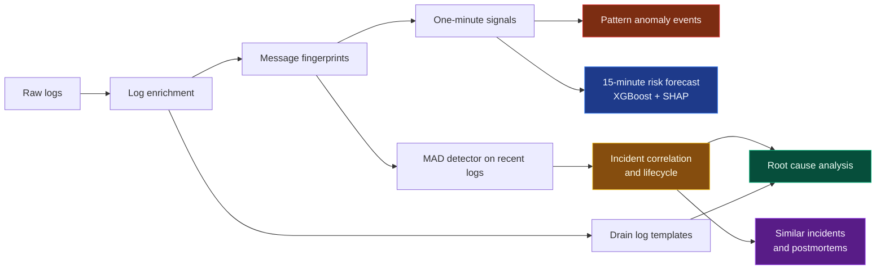
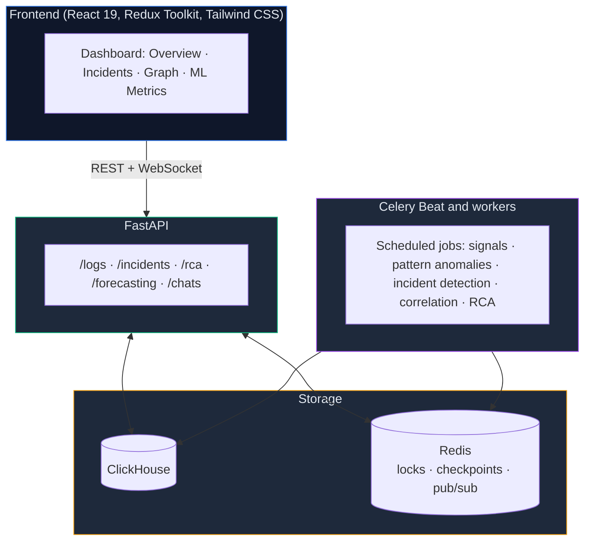

# AutoLogExplain

> **A semi-automated SRE platform for investigating logs.** AutoLogExplain turns raw application logs into structured incidents, ranks likely root causes, and forecasts the risk of anomalous activity over the next 15 minutes.

## Pipeline



## Architecture



The backend uses Python 3.11, FastAPI, Celery, ClickHouse, and Redis. The forecast uses XGBoost and SHAP. The React dashboard uses Redux Toolkit, RTK Query, Tailwind CSS, and Vite.

A typical incident moves from `open` to `acknowledged`, `mitigated`, and `resolved`. A resolved incident can be `reopened`. The system records changes in the append-only `incident_events` table.

## Requirements

- Docker 24.0+ and Docker Compose 2.20+ for the backend stack.
- Python 3.11 for the demo and evaluation scripts.
- Node.js 20.19 or later in the 20.x line, or Node.js 22.12+. The version used with nvm is recorded in [`.nvmrc`](.nvmrc).

## Quick Start

Run these commands from a fresh checkout. The demo script recreates the log and incident tables in the local stack and loads synthetic data.

```bash
cp backend/.env.example backend/.env
docker compose -f backend/docker-compose.yaml up --build --wait api
bash e2e-artifacts/full_pipeline.sh
docker compose -f backend/docker-compose.yaml exec -T api \
  python e2e-artifacts/evaluate_detectors.py
docker compose -f backend/docker-compose.yaml up -d worker beat
(cd frontend && npm ci && npm run dev)
```

Open the [dashboard](http://localhost:5173) or the [API reference](http://localhost:8080/docs). To enable the optional YandexGPT chat, copy [`analytics/.env.example`](analytics/.env.example) to `analytics/.env` and supply valid Yandex Cloud credentials.

The repository includes a trained XGBoost model. The following commands regenerate the synthetic training data and retrain the model.

```bash
python3 e2e-artifacts/generate_training_dataset.py
docker compose -f backend/docker-compose.yaml exec -T api \
  python -m backend.services.forecasting.trainer
```

## Subsystems

| Layer | Module | Purpose |
|---|---|---|
| Log enrichment | [`log_tags.py`](backend/services/log_tags.py) | Assigns rule-based categories and normalizes severity. |
| Fingerprinting | [`log_fingerprints.py`](backend/services/log_fingerprints.py) | Masks variable tokens such as numbers, UUIDs, and IP addresses, then hashes the template together with the service and category. |
| Log templates | [`log_clustering.py`](backend/services/log_clustering.py) | Uses a Drain-style algorithm to extract representative templates for investigation reports. |
| Signals | [`signals/`](backend/services/signals/) | Builds minute-level counts and records volume spikes and bursts of previously rare fingerprints. |
| Incident detection | [`incidents/engine.py`](backend/services/incidents/engine.py) | Scores recent log counts using median absolute deviation (MAD) and writes incident candidates. |
| Incident management | [`incidents/`](backend/services/incidents/) | Correlates candidates, updates incident status, and records an event history. Redis locks coordinate background jobs. |
| Service graph | [`dependency_graph.py`](backend/services/dependency_graph.py) | Infers directed edges from the order in which services first appear in shared traces. |
| Root cause analysis | [`rca_engine.py`](backend/services/rca_engine.py) | Assembles on-demand reports with an anomaly timeline, a possible cascade path, and log templates. |
| SLO monitoring | [`slo_tracker.py`](backend/services/slo_tracker.py) | Reports log-based error-budget burn rates over 1h, 6h, and 24h in the on-demand API. |
| Forecasting | [`forecasting/`](backend/services/forecasting/) | Uses 32 features to estimate anomaly risk in the next 15 minutes and returns the five largest per-prediction SHAP contributions. |
| Similar incidents | [`similar_incidents/`](backend/services/similar_incidents/) | Ranks stored incidents using token overlap, cosine similarity, and exact matches on incident fields. |
| Postmortems | [`postmortem/`](backend/services/postmortem/) | Generates a deterministic Markdown report from stored incident evidence. |
| Log chat | [`analytics/`](analytics/) | Uses YandexGPT with tools for querying ClickHouse, profiling fields, and retrieving traces. |

### Root cause scoring

The background RCA job ranks candidate services using this weighted score.

```text
rca_score = 0.35 * anomaly + 0.25 * earliness + 0.20 * fanout + 0.20 * criticality
```

- `anomaly` is derived from the strength of the incident's recent anomalies.
- `earliness` reflects when the service first appeared in the incident's traces.
- `fanout` is the normalized number of outgoing dependencies in the stored graph.
- `criticality` comes from the stored dependency edges when available.

The on-demand report's confidence score gives 0.25 each for an anomaly, a trace graph, a reconstructed cascade path, and a service-level objective (SLO) alert.

### Forecast evaluation

The task is to forecast anomalous activity during the next 15 minutes, including activity that continues from an ongoing anomaly. On a synthetic dataset of **60,480 service-minute observations**, the stratified random split used **45,360** rows for training and **15,120** for model selection. The recorded scores were **0.978 ROC-AUC** and **0.785 average precision**. [Label generation](e2e-artifacts/generate_training_dataset.py) · [Training code](backend/services/forecasting/trainer.py) · [Saved metrics](backend/services/forecasting/models/forecaster_metrics.json)

## API

The backend exposes an interactive OpenAPI reference at `/docs`.

| Path | Purpose |
|---|---|
| `GET /logs/list`, `GET /logs/categories`, `GET /logs/tree` | Browse logs, category summaries, and available products, services, and environments. |
| `GET /incidents`, `GET /incidents/{incident_id}` | List incidents and read an incident record. |
| `PATCH /incidents/{incident_id}/status` | Update an incident's status. |
| `GET /incidents/{incident_id}/{timeline,evidence,similar,postmortem}` | Read the event history, evidence, similar incidents, or Markdown postmortem. |
| `POST /rca/analyze/{fingerprint}` | Generate an on-demand RCA report. |
| `GET /rca/{graph,templates,slo,reports,metrics}` | Inspect the trace graph, log templates, SLO burn rates, saved reports, or detector comparison. |
| `GET /forecasting/info`, `GET /forecasting/risk?hours=2` | Read model metadata or get current risk scores and SHAP explanations. |
| `POST /chats/new` and `WS /ws/chats/{chat_id}` | Create a chat and exchange messages over WebSocket. |

## ClickHouse tables

| Table | Purpose |
|---|---|
| `logs` | Source application logs. |
| `log_signals_1m` | One-minute counts grouped by service, environment, category, severity, and fingerprint. |
| `fingerprint_catalog` | Catalog of normalized message fingerprints and observed examples. |
| `anomaly_events` | Volume spikes and bursts of previously rare fingerprints from the signal pipeline. |
| `incident_candidates`, `incidents`, `incident_events` | Incident candidates, versioned incident records, and event history. |
| `slo_burn` | Stored burn rates for 5m, 1h, and 6h windows. |
| `service_dependency_graph` | Stored dependency edges used by the background RCA job. |

The backend creates the derived tables at startup. Populate the source `logs` table separately or use the local demo.

## Configuration

| Variable | Local default | Purpose |
|---|---|---|
| `CLICKHOUSE_HOST` | `clickhouse` | ClickHouse host for backend services. |
| `REDIS_HOST` | `redis` | Redis host for Celery, locks, and pub/sub. |
| `TOKEN_SECRET` | Local development value in the template | Secret used to sign chat tokens. |
| `INCIDENT_ANOMALY_THRESHOLD` | `3.5` | MAD score threshold for incident candidates. |
| `INCIDENT_CORRELATION_WINDOW_MINUTES` | `30` | Time window for grouping related incident candidates. |
| `YC_FOLDER_ID`, `YC_API_KEY` | Set for YandexGPT chat | Yandex Cloud folder and API key. |

[Backend environment template](backend/.env.example) · [Analytics environment template](analytics/.env.example) · [Backend settings](backend/core/config.py)

## Testing

Run the unit tests from the repository root. The backend test command uses a local Poetry environment with development dependencies.

```bash
(cd backend && poetry install --no-root)
(cd backend && PYTHONPATH=.. poetry run python -m pytest tests/unit)

(cd frontend && npm ci && npm test && npm run build)
```

The demo's [detector evaluator](e2e-artifacts/evaluate_detectors.py) compares MAD, classic z-score, rolling standard deviation, and Isolation Forest on labelled synthetic windows. It reports results at a fixed threshold and after selecting a threshold on the same data.

## Contributors

Contributors include [Anastasiia Lelekova (@aslelekova)](https://github.com/aslelekova) and [Alexandra Ovsyannikova (@Sghe-x5)](https://github.com/Sghe-x5). See the [full contribution history](https://github.com/Sghe-x5/autologexplain/graphs/contributors?all=1) for all contributors.
